# Detecting Illicit Bitcoin Transactions Under Concept Drift

*Introduction to Data Science for Engineers: Project Report (Part A)*

---

## 1. Introduction

Bitcoin lets anyone send money without a bank, and it records every payment on a public ledger. Most of the money moves for ordinary reasons, but a small share belongs to scams, ransomware, darknet markets and similar crime. Investigators must find the illicit transactions among hundreds of thousands of normal ones. Machine learning can help, but it faces a problem that routine classification exercises ignore: **criminals change their behaviour**, so a model that works on last year's criminals may quietly stop working on this year's. This project builds a complete, reproducible data-science pipeline for the Elliptic Bitcoin dataset, measures honestly how well illicit transactions can be detected, and studies how and when that ability collapses over time (*concept drift*).

## 2. Problem statement

> **Can a machine-learning model look at a Bitcoin transaction and tell whether it is illicit or licit, and does that ability still hold when criminals change their behaviour over time?**

This is a binary classification task (illicit = 1, licit = 0). It is hard for five reasons: illicit transactions are rare; most transactions carry no label; the 166 features are anonymised; behaviour drifts over time; and false negatives and false positives have different costs, so accuracy is the wrong yardstick.

**Research questions.**

1. How much does a random split overstate performance compared with a temporal split?
2. How do models perform per time step, and where does performance collapse?
3. Does a tuned tree-based model compete with graph information, and do the aggregated neighbour features explain it?
4. Can retraining on recent data or removing unstable features reduce drift damage?
5. (Extension) Does adding wallet-address information improve detection? *Not attempted; see Section 15.*

**Success criteria.** Primary metrics are illicit-class F1 and PR-AUC on the held-out future period; every model is compared with a baseline on the same split; results are reported per time step; and the work is reproducible. We set no accuracy target.

## 3. Dataset description

We use the **Elliptic dataset** (Weber et al., 2019), released publicly by the blockchain-analytics company Elliptic. It is a real graph in which each **node is a transaction** and each **edge is a flow of coins** from one transaction into another. It was chosen because it is real, large enough for proper training, validation and testing, published with a peer-reviewed study, and the benchmark for the problem.

| Item | Value |
|---|---|
| Transactions (nodes) | 203,769 |
| Payment flows (edges) | 234,355 |
| Time steps | 49 (about two weeks each) |
| Features per transaction | 166 = time step + 93 *local* + 72 *aggregated-neighbour* |
| Labelled illicit | 4,545 (2.2%) |
| Labelled licit | 42,019 (20.6%) |
| Unknown | 157,205 (77.1%) |

The three files are the feature table (no header), the class table (`1` illicit, `2` licit, `unknown`) and the edge list. *Local* features describe the transaction itself; *aggregated* features summarise its neighbours, so graph information is also available in tabular form. All 166 features are anonymised: **we never attach real-world meaning to any column.**

## 4. Data preparation

The files were joined and every join was verified with assertions: transaction ids are unique in both tables, the two id sets are identical, the join is one-to-one and all edge endpoints exist. Labels were recoded to `1`/`0`/`-1` (illicit/licit/unknown). The table below records each decision in the form *problem → why it matters → action → why appropriate*.

| Problem | Why it matters | Action | Why appropriate |
|---|---|---|---|
| 77.1% of transactions are **unlabelled** | No ground truth to learn from or be scored on; treating them as licit would add label noise | Excluded from every train/validation/test set and supervised metric; used only for label-free tasks (graph degree, input-drift measurement) | Keeps evaluation honest while still using the data where no label is needed |
| **Missing values**: none (no infinities either) | Would break models | No imputation needed now, but a median imputer fitted on training rows is part of every pipeline | Robust to uploaded CSVs without leaking test statistics |
| **Duplicates**: no duplicate ids, edges or self-loops; 34 duplicate *feature rows* (49 rows, 15 groups) | Could leak between train and test | All groups lie within one time step and none has conflicting labels, so they were kept | Distinct transactions (0.017%); cannot cross a chronological split |
| **Heavy tails**: the median feature has 13.4% of its values beyond 3×IQR (max 38.3%) | Distorts linear models; may be genuine behaviour | **Not removed.** Trees are scale-invariant; Logistic Regression uses standardisation (training statistics) plus clipping at ±5 SD | Extremes are mostly licit transactions (Section 5), so removing them would remove signal |
| **Data types** | 690 MB CSV with float64 | `float32` features, `int16` time step, `int8` label; explicit column names | Smaller and readable, no relevant precision loss |
| **Time step** is a column of the feature file | Using it as an input lets a model memorise *when*, which is useless for the future | Used only for splitting and per-step evaluation | Avoids a form of leakage |
| **Edges never cross time steps** (verified: 100% within a step) | Cross-step edges would leak the future into graph features | Verified | Graph features can be computed per step without future information |
| **Class imbalance**: 9.8% of labelled transactions are illicit | Accuracy misleading | Class weights / `scale_pos_weight`; illicit-class metrics; majority baseline | See Section 10 |

## 5. Exploratory data analysis

Every figure below answers one question. Red is illicit, blue licit, grey unknown.

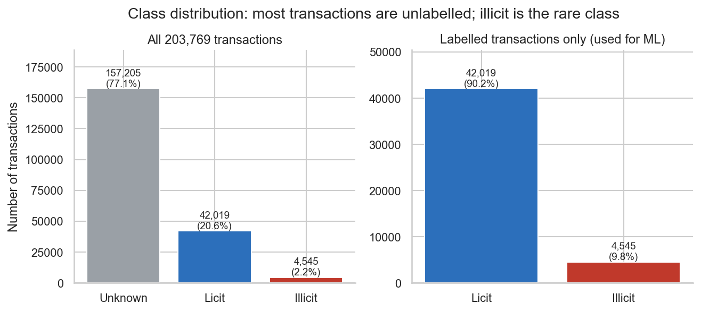

**Class distribution.** 77.1% of transactions are unlabelled; among the labelled ones only 9.8% are illicit. A classifier that always says "licit" scores about 90% accuracy and catches nothing, so we do not use accuracy.

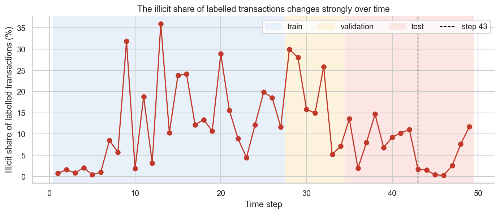

**Illicit share over time.** The illicit share of labelled transactions ranges from 0.3% (step 46) to 36% (step 13). It averages 9.9% in training, **20.2% in validation**, 9.2% in steps 35–42 and **2.5% in steps 43–49** (169 illicit transactions). The base rate itself drifts, which is the first sign that the future does not look like the past, and it means a threshold tuned on the illicit-rich validation period will behave differently later.

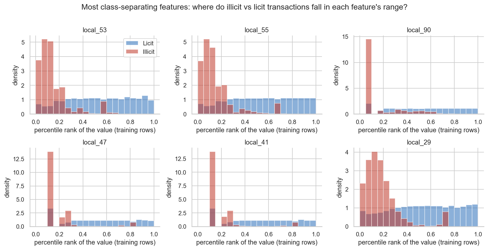

**Do single features separate the classes?** Each panel shows the percentile rank of a feature's value. Illicit transactions concentrate at the low end of `local_53`, `local_55` and pile up in one low bin for `local_90`, `local_47`, `local_41`, whereas licit ones are spread evenly. A single feature reaches a univariate AUC of 0.89, so the classes are separable but no single feature is decisive (the largest standardised mean difference is about one standard deviation).

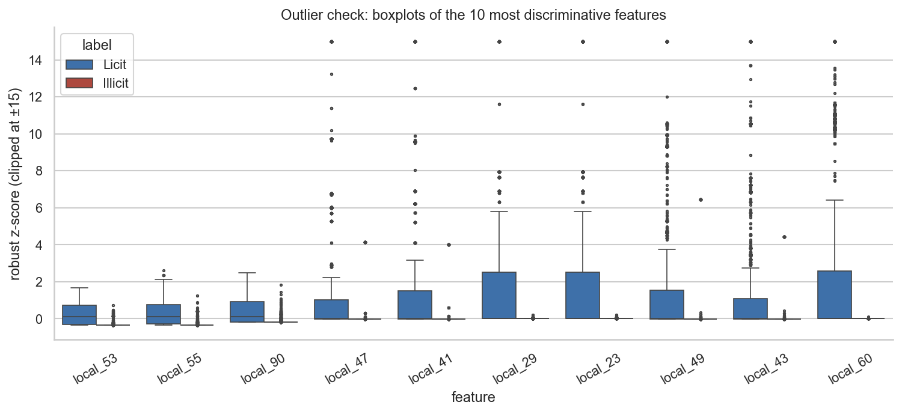

**Are the extremes errors?** No. Values with robust z-scores above 10 belong almost entirely to licit transactions; illicit transactions occupy a narrow band. Removing "outliers" would delete information about the licit class, so they are kept.

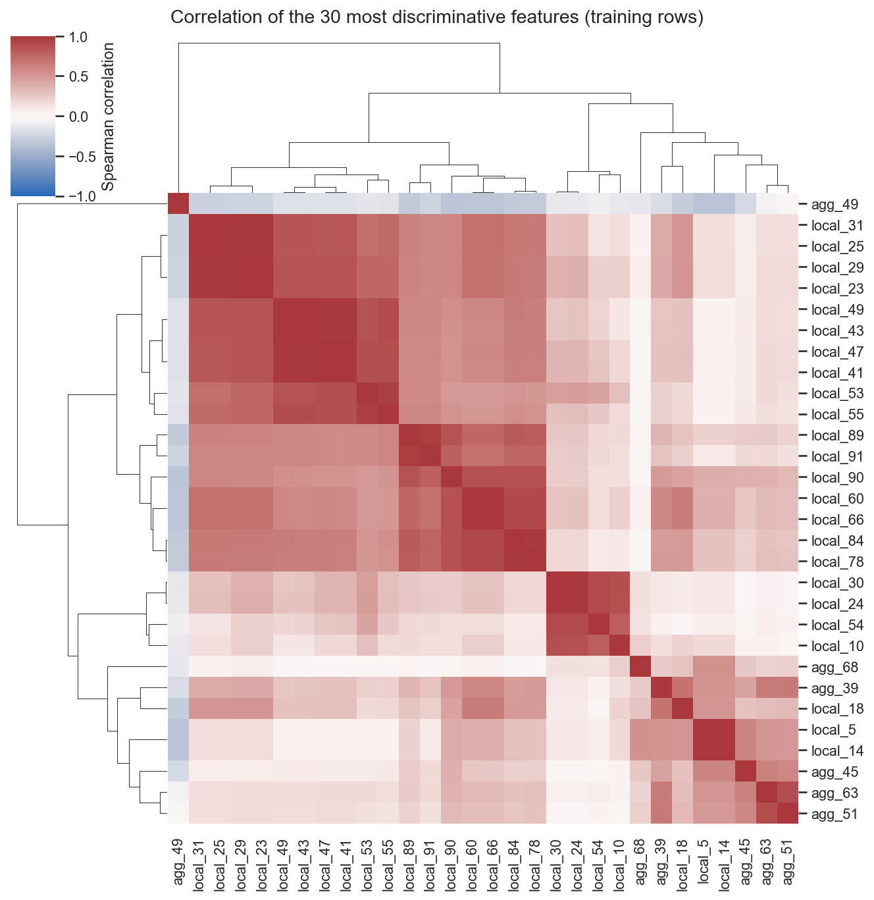

**Redundancy.** There are blocks of near-duplicate local features (e.g. `local_23/25/29/31`). Overall 131 of 13,530 feature pairs (1.0%) have |ρ| > 0.9. Redundancy is real but limited, and it means individual feature-importance values should be read as indicative only.

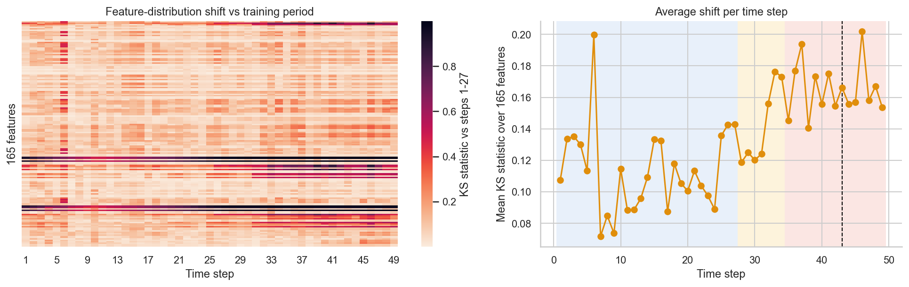

**Initial evidence of drift in the inputs.** Using the Kolmogorov–Smirnov statistic against the training period (all transactions, no labels), the average feature shift rises from 0.113 (steps 1–27) to 0.142 (28–34), 0.164 (35–42) and 0.166 (43–49); the share of features with KS above 0.2 doubles from 11% to 21%. The input drift is gradual and does not jump at step 43, so the abrupt performance collapse seen later suggests a change in the *relationship* between features and label rather than input shift alone.

## 6. Feature engineering

We added features that use only same-time-step information (all edges join transactions of one step, so no future data is used, and neighbour *labels* are never used):

* `in_degree`, `out_degree`, `degree`, `step_tx_count`;
* the mean over in- and out-neighbours of the 8 most important local features (selected by a Random Forest fitted on training rows only).

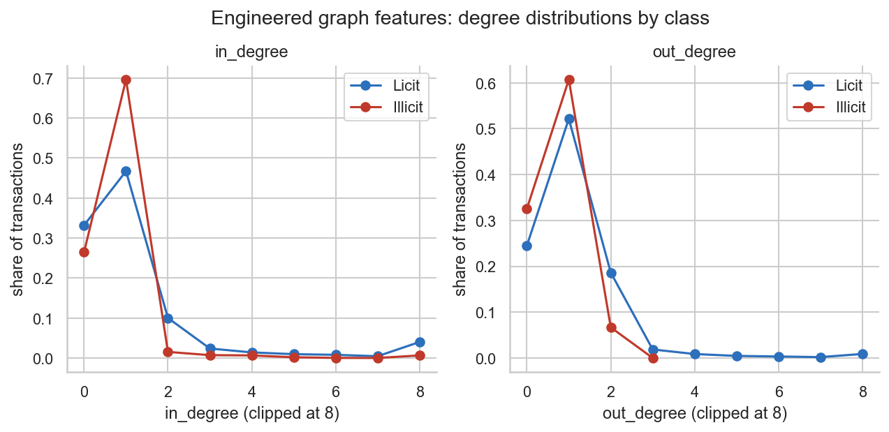

Illicit transactions are less connected (mean degree 2.0 vs 3.1; only 6.7% have out-degree ≥ 2 against 23.3% of licit ones), but the distributions overlap strongly.

**Do they help?** Not consistently. In expanding-window cross-validation (steps 1–34) the 165 original features scored a mean PR-AUC of 0.9464 versus 0.9455 with the engineered features, so the original set was kept (decided without test data). Looking at the test period afterwards for transparency, PR-AUC is essentially unchanged (Random Forest 0.784 → 0.786; XGBoost 0.783 → 0.781); F1 moves in opposite directions (+0.039 and −0.014).

A related ablation shows where the signal lives (test PR-AUC, Random Forest / XGBoost): 93 local features only: 0.773 / 0.750; 72 aggregated features only: 0.606 / 0.632; all 165: 0.784 / 0.783. Local features carry most of the signal; the neighbour aggregates add a modest 0.01–0.03.

## 7. Methodology

The pipeline is: load and verify → clean (Section 4) → engineer features (Section 6) → chronological split → tune with time-aware validation → select threshold on validation → evaluate **once** on the future test period → analyse drift and errors. Every random component uses seed 42, and re-running the saved configurations reproduces the stored predictions exactly (maximum difference 0.0).

## 8. Temporal train / validation / test split

| Period | Steps | Role | Labelled rows (illicit) |
|---|---|---|---|
| Train | 1–27 | fit models | 24,923 (2,457; 9.9%) |
| Validation | 28–34 | tune, choose threshold and feature set | 4,971 (1,005; 20.2%) |
| Test | 35–49 | evaluated once at the end | 16,670 (1,083; 6.5%) |

The proposed split of 1–27 / 28–34 / 35–49 was kept: every period contains a substantial number of illicit cases, and the test period contains step 43. **Why not a random split?** Neighbouring transactions are strongly related, so a random split puts near-copies of test transactions into training. Section 11 quantifies this.

Leakage controls (each unit-tested or asserted in code): unknown labels removed before splitting; the split is asserted to be strictly chronological; imputation and scaling live inside pipelines fitted on training rows only; hyper-parameters are tuned with **expanding-window cross-validation** (train 1–13 → validate 14–20; train 1–20 → 21–27; train 1–27 → 28–34), which never touches steps 35–49; the F1-optimal threshold is chosen on validation predictions; the time step is not a feature; and `scale_pos_weight` is computed from training labels.

## 9. Model implementation

| Model | Why included | Principle | Hyper-parameters searched | Selected |
|---|---|---|---|---|
| Majority baseline | Floor to beat; shows why accuracy misleads | Always predicts licit | none | – |
| Logistic Regression | Simple, interpretable | Sigmoid of a weighted feature sum; class-weighted | C ∈ {0.01, 0.1, 1} | C = 1 |
| Random Forest | Non-linear interactions; robust to heavy tails | Many decorrelated trees vote; balanced class weights | max depth {12, none}, min leaf {1, 3}, max features {√p, 0.3} (300 trees) | depth none, leaf 1, √p |
| XGBoost | Strong tabular learner | Trees added sequentially, each correcting the previous errors; `scale_pos_weight` = licit/illicit | depth {4, 6, 8}, learning rate {0.05, 0.1}, trees {200, 400} | depth 8, rate 0.1, 200 trees |

Tuning matters little for the trees: across the whole grid the mean cross-validated PR-AUC varies by only 0.013 (Random Forest) and 0.005 (XGBoost). Logistic Regression is worse in every fold. Graph neural networks and an MLP were optional and were **not** implemented (Section 15).

## 10. Evaluation metrics

All metrics are for the **illicit class**. *Precision*: of the transactions flagged illicit, the fraction that truly are (few false alarms). *Recall*: of all illicit transactions, the fraction caught (little crime slips through). *F1*: balances the two. *PR-AUC* (average precision): quality across all thresholds, the standard summary for imbalanced data. ROC-AUC is reported only as supplementary information because it looks flattering when negatives dominate. Accuracy is reported only to show how misleading it is.

## 11. Model comparison

**Validation (steps 28–34).** Random Forest PR-AUC 0.989 / F1 0.965; XGBoost 0.985 / 0.950; Logistic Regression 0.636 / 0.650; majority 0.202 / 0.

**Test (steps 35–49), thresholds chosen on validation:**

| Model | Precision | Recall | F1 | PR-AUC | ROC-AUC | Accuracy | TP | FP | FN |
|---|---|---|---|---|---|---|---|---|---|
| Majority baseline | 0.000 | 0.000 | 0.000 | 0.065 | 0.500 | 0.935 | 0 | 0 | 1083 |
| Logistic Regression | 0.148 | 0.920 | 0.255 | 0.257 | 0.859 | 0.651 | 996 | 5734 | 87 |
| Random Forest | 0.796 | 0.722 | 0.757 | 0.784 | 0.925 | 0.970 | 782 | 201 | 301 |
| XGBoost | 0.914 | 0.675 | 0.776 | 0.783 | 0.927 | 0.975 | 731 | 69 | 352 |

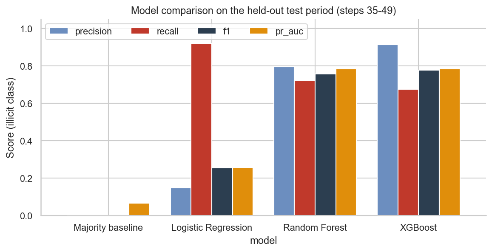

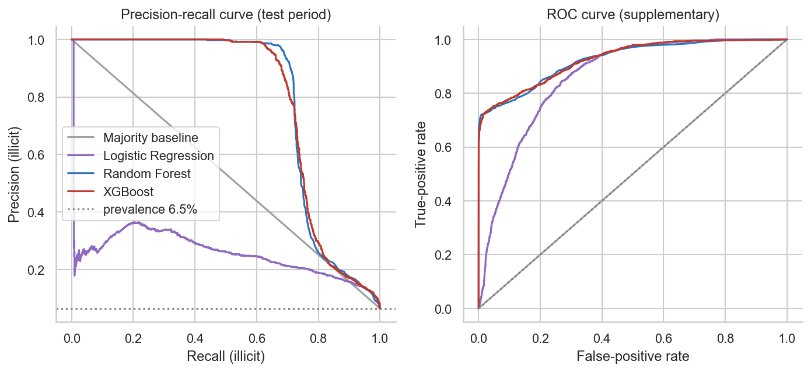

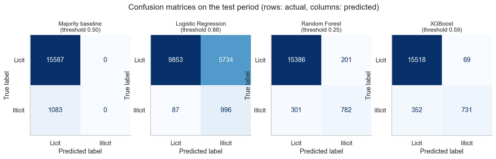

**Interpretation.** The majority baseline reaches 93.5% accuracy yet has zero recall and F1: accuracy is misleading. Logistic Regression catches most illicit transactions (recall 0.92) but with 5,734 false alarms (precision 0.15): a linear boundary cannot separate the classes. Both tree models are far better. They tie on PR-AUC (difference 0.001; 95% bootstrap interval −0.005 to +0.005), while XGBoost's F1 is about 0.02 higher (interval 0.007 to 0.033) because it raises far fewer false alarms (69 vs 201) at the price of more misses (352 vs 301). The choice between them is therefore a **trade-off between false positives and false negatives**:

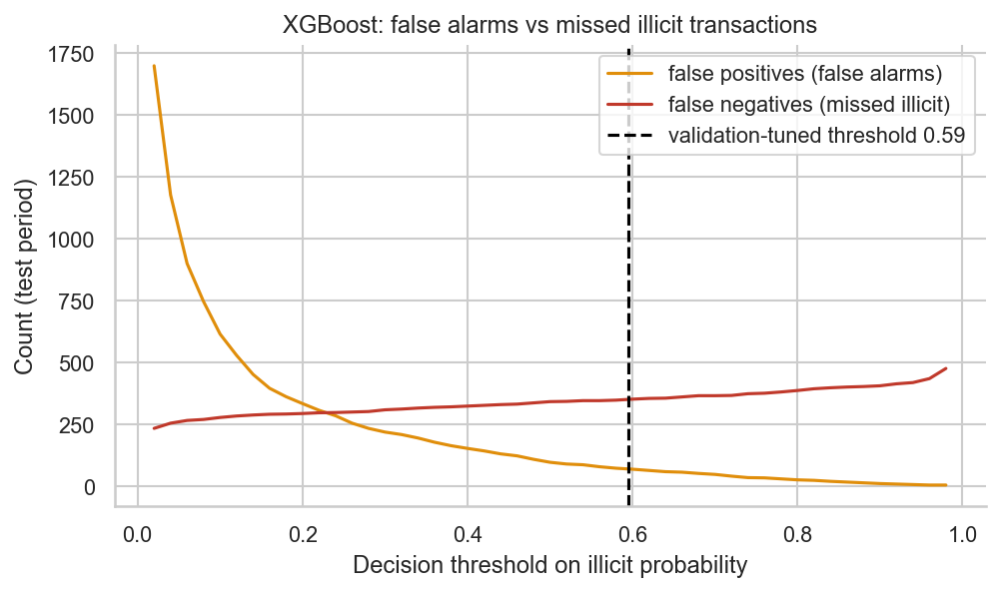

raising the threshold cuts false alarms and increases misses. Investigator capacity and the cost of a missed case should set the operating point.

**Best model.** By the rule fixed before looking at the test period (validation PR-AUC and F1), **Random Forest is best**. On the test period, Random Forest and XGBoost are statistically tied on PR-AUC. We use XGBoost as the default in the demonstration application because it gives fewer false alarms and exact per-prediction feature contributions; this is a judgement made after seeing test results and does not change the selection above.

### Research question 1: random vs temporal split

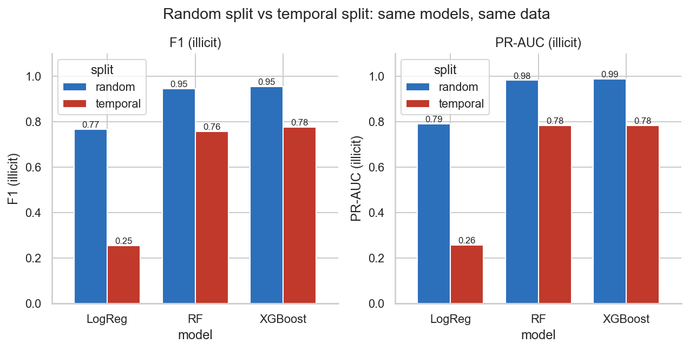

With identical models and data, a random split reports F1 0.945 (Random Forest) and 0.955 (XGBoost) versus 0.757 and 0.776 for the chronological split; PR-AUC is 0.98–0.99 versus 0.78. Logistic Regression drops from 0.766 to 0.255. A random split therefore overstates F1 by about 0.18–0.19 for the tree models and 0.51 for the linear model. The temporal split is the honest estimate because deployment means scoring transactions that occur *after* the training data.

## 12. Concept drift analysis

> The shutdown of a major darknet market around step 43 is a plausible explanation for the behaviour change, but it is a **hypothesis**: this dataset shows *when* behaviour changes, not *why*.

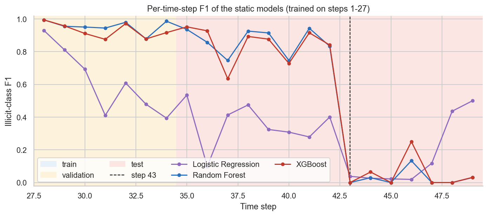

**Where does performance collapse (RQ2)?** All models perform well from step 28 to 42. For steps 35–42 Random Forest and XGBoost reach per-step F1 between 0.63 and 0.95. At **step 43 F1 falls to 0.00** and stays near zero (≤ 0.06) in steps 44–49, apart from a noisy spike at step 46, which has only two illicit transactions.

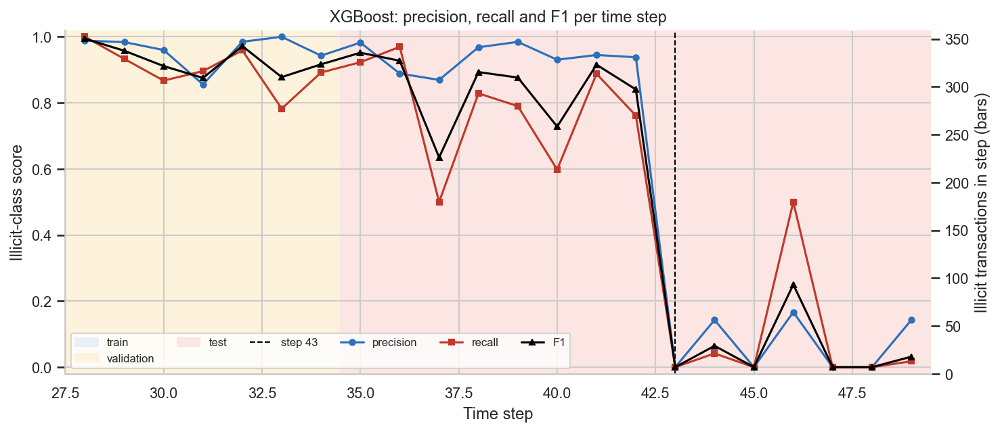

Before step 43 XGBoost has precision 0.87–0.98 and recall 0.50–0.97. Afterwards recall is 0 at steps 43, 45, 47, 48 and 0.02–0.04 at steps 44 and 49. Pooled over steps 43–49 the static XGBoost model catches **3 of 169** illicit transactions (against 728 of 914 before step 43). The loss is a loss of *detection*, not a flood of false alarms.

### Drift adaptation: static vs sliding vs expanding retraining (RQ4)

For each step *t*, the model is (re)trained on earlier steps only. *Static*: trained once on steps 1–27. *Expanding*: all labelled steps before *t*. *Sliding*: the last 10 steps before *t*. Assumption: labels of step *t − 1* are available when scoring step *t* (optimistic). All variants use the same hyper-parameters and a fixed threshold of 0.5.

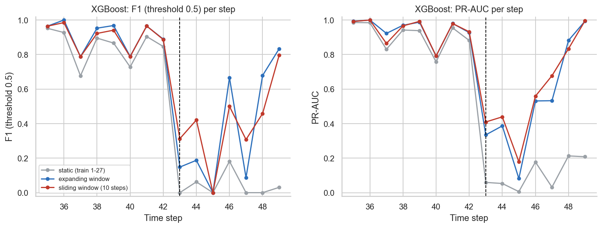

| Model | Strategy | F1 (35–49) | PR-AUC (35–49) | Recall (43–49) | F1 (43–49) |
|---|---|---|---|---|---|
| XGBoost | Static | 0.771 | 0.783 | 0.018 | 0.027 |
| XGBoost | Expanding | **0.873** | **0.915** | 0.391 | 0.543 |
| XGBoost | Sliding (10) | 0.864 | 0.913 | 0.391 | 0.532 |
| Random Forest | Static | 0.693 | 0.784 | 0.018 | 0.034 |
| Random Forest | Expanding | 0.820 | 0.898 | 0.018 | 0.034 |
| Random Forest | Sliding (10) | 0.810 | 0.881 | 0.006 | 0.012 |

Retraining helps substantially: pooled XGBoost F1 rises from 0.771 to 0.873 and, in the collapsed period, recall rises from 0.018 to 0.391. Random Forest at a fixed threshold of 0.5 still misses almost everything after step 43, although its PR-AUC there rises from 0.045 to 0.565: its ranking improves but its probabilities stay too low for the fixed threshold. Expanding and sliding windows perform alike (about 0.01 F1 apart). **Trade-offs:** retraining needs a steady supply of fresh, confirmed labels (an operational cost), repeated training and monitoring, and it does not restore early performance (F1 0.54 vs about 0.9 earlier). Drift is **reduced, not solved.**

### Removing unstable features

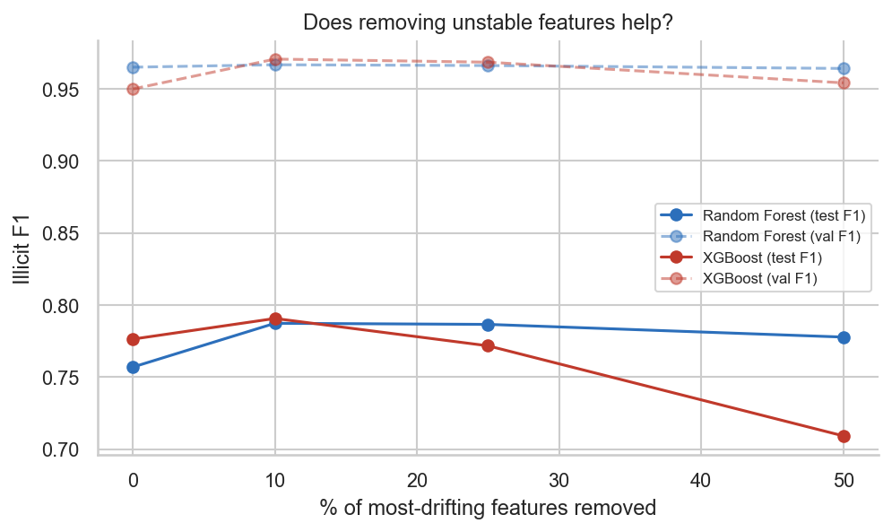

Features were ranked by their KS shift between training and validation periods (no test data) and the most-shifted fraction was dropped. Removing the top 10% improved validation F1 for both models (Random Forest 0.965 → 0.967; XGBoost 0.950 → 0.971) and test F1 (0.757 → 0.787; 0.776 → 0.791); removing 50% hurt XGBoost (test F1 0.709). This is a small gain (about 0.015–0.03 F1) and not a fix for the collapse after step 43.

## 13. Error analysis and feature importance

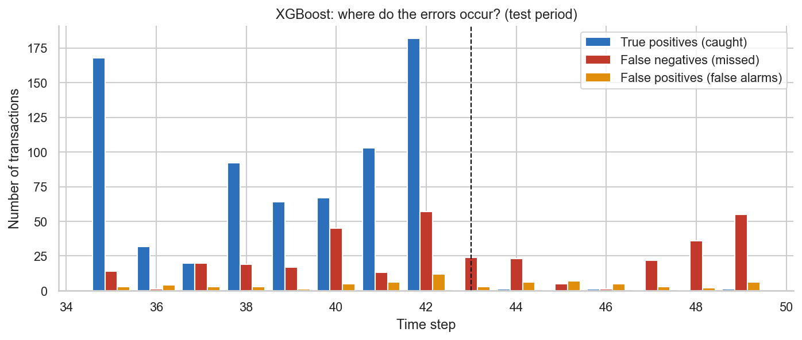

**Where are the errors?** Of XGBoost's 352 false negatives, **166 (47%) occur in steps 43–49**, which hold only 16% of the illicit test transactions. **False negatives are confident misses**: 79% received an illicit probability below 0.1 (mean 0.08, against 0.975 for caught transactions). The late illicit transactions look licit to the model, the signature of concept drift rather than noise. False positives are few and stable (69 in total).

**Same places?** All 301 illicit transactions missed by Random Forest are also missed by XGBoost (Jaccard 0.86), so the two share a blind spot, consistent with a data-level cause. For false alarms they disagree (only 40 shared; Jaccard 0.17).

On the most discriminative features (z-scores against training), caught illicit transactions are far below average (`local_53`: −1.00), licit ones near the middle (−0.31) and **missed illicit transactions in between (−0.62)**: they partly resemble licit transactions.

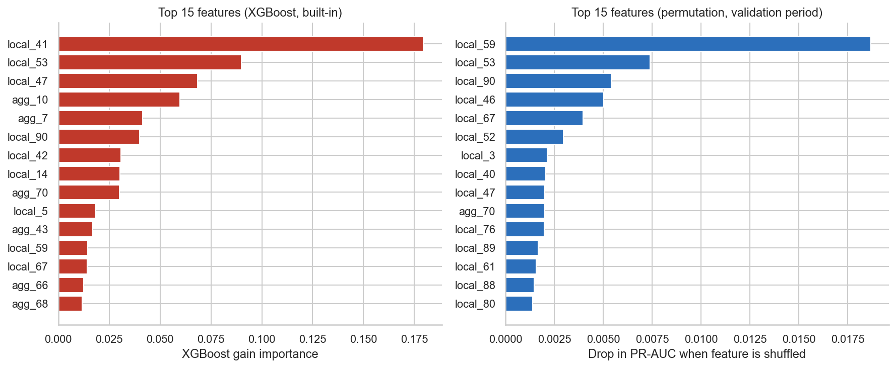

**Which features matter?** XGBoost relies on a few local features (`local_41` carries 18% of gain, `local_53` 9%, `local_47` 7%) plus aggregated `agg_10` and `agg_7`; Random Forest spreads importance over the correlated block `local_41/43/47/49/53/55`; permutation importance on validation ranks `local_59`, `local_53`, `local_90` highest. Different methods favour different members of correlated groups, so rankings should not be over-interpreted, and **the columns have no known real-world meaning.**

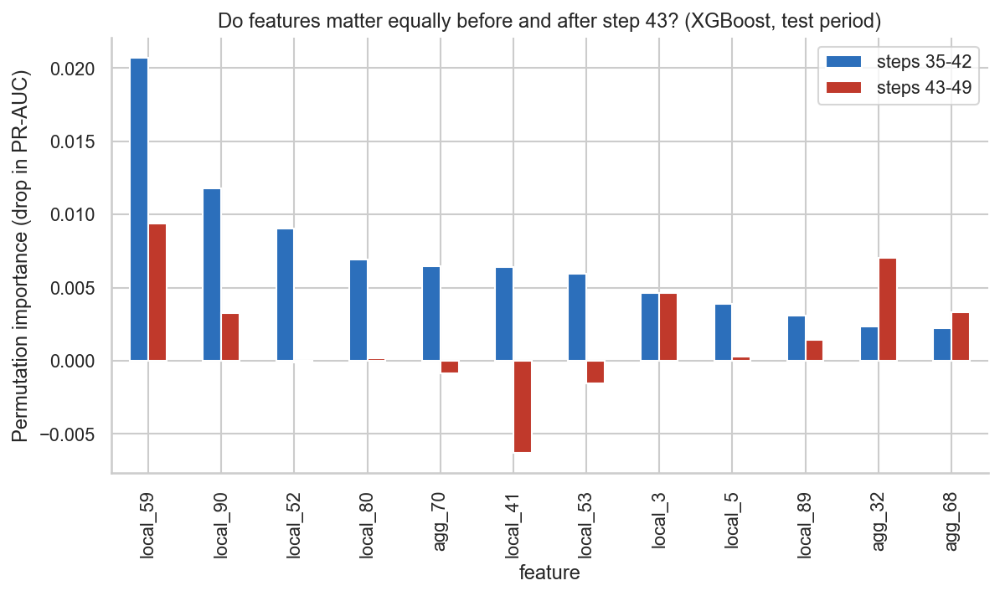

**Do features stop mattering?** Yes. Permutation importance of `local_59` halves after step 43 (0.021 → 0.009), `local_90` falls from 0.012 to 0.003, `local_52` and `agg_70` fall to about zero, and `local_41` turns negative (−0.006): shuffling it slightly *improves* PR-AUC. The rank correlation of XGBoost importances between models trained on different periods is only 0.32–0.40.

## 14. Results and discussion

1. **Honest evaluation matters.** A random split overstates F1 by about 0.18–0.19 for tree models; the temporal estimate is about 0.76–0.78.
2. **Tree models work well in-regime.** Random Forest and XGBoost reach test PR-AUC 0.78; they beat a linear model by a wide margin, and the baseline's 93.5% accuracy is meaningless.
3. **Performance collapses at step 43.** In steps 43–49 the static models detect almost nothing (3 of 169), while input drift is gradual, suggesting a change in the feature–label relationship. The darknet-shutdown explanation is plausible but unproven.
4. **Retraining helps but does not solve drift** (pooled F1 0.77 → 0.87, collapsed-period F1 0.03 → 0.54 for XGBoost) and requires fresh labels; dropping the 10% most-shifted features gives a small gain.
5. **Graph information in tabular form helps modestly** (+0.01–0.03 PR-AUC); local features carry most of the signal. Whether a GNN would do better remains untested here.
6. **Operationally**, the system should flag candidates for human investigators, be monitored for drift (e.g. the KS statistic and falling flag rates), and be retrained when new labels arrive.

## 15. Limitations

* **Anonymised features**: importance shows which columns matter, never what they mean.
* **77% unlabelled**: the supervised view covers a minority of the data and the labelled sample may be biased toward cases that were easy to confirm.
* **Label quality** comes from one company's methods and may contain errors.
* **Single time window** (49 steps): findings may not transfer to Bitcoin today.
* **Step 43 explanation** is a hypothesis, not a result of this analysis.
* **Noisy late steps**: several late steps contain very few illicit transactions (e.g. 2 at step 46), so single-step scores are unreliable; pooled figures are more trustworthy.
* **Base-rate shift**: the validation period has 20.2% illicit versus 6.5% in the test period, so thresholds tuned on validation transfer imperfectly.
* **Retraining experiment assumes immediate labels** for the previous step, which is optimistic in practice.
* **Post-hoc choice**: using XGBoost as the application default was decided after seeing test results (the selection by the pre-declared rule is Random Forest).
* **Not done**: graph neural network, MLP and the Elliptic++ extension were optional and were not implemented; therefore research questions 3 (versus a GNN) and 5 are only partly addressed or open.
* **Ethical note**: a model like this can wrongly flag innocent users. Its output is a statistical signal, not proof, and should support human investigators, not replace them.

## 16. Conclusion

On the Elliptic dataset, tree-based models detect illicit Bitcoin transactions well when the future resembles the past (test PR-AUC 0.78, F1 0.76–0.78), far better than a linear model and a trivial baseline, and a random split would have hidden how fragile that result is. The central finding is concept drift: from time step 43 the static models detect almost no illicit transactions (3 of 169), because the relationship between the features and illicit behaviour changed rather than because the inputs jumped. Retraining on recent labelled data recovers part of the lost performance but needs fresh labels and does not restore the earlier level. The evidence supports using such a model as a monitored decision-support tool that is regularly retrained, not as an autonomous detector.

## 17. Future improvements

* Train a GCN/GraphSAGE and an MLP to test the tree-versus-graph question directly.
* Add the Elliptic++ wallet-address data (about 800,000 addresses) to test whether an actor view improves detection.
* Use drift detectors (KS/PSI, performance monitoring on delayed labels) to trigger retraining automatically; model label delay explicitly.
* Make the decision threshold adaptive to the changing base rate; calibrate probabilities (the Random Forest result suggests miscalibration after drift).
* Use semi-supervised learning on the 157,205 unlabelled transactions.
* Cost-sensitive evaluation with real investigator costs.

## 18. References

1. Weber, M., Domeniconi, G., Chen, J., Weidele, D. K. I., Bellei, C., Robinson, T., Leiserson, C. E. (2019). *Anti-Money Laundering in Bitcoin: Experimenting with Graph Convolutional Networks for Financial Forensics.* KDD Workshop on Anomaly Detection in Finance. arXiv:1908.02591.
2. Elmougy, Y., Liu, L. (2023). *Demystifying Fraudulent Transactions and Illicit Nodes in the Bitcoin Network for Financial Forensics* (Elliptic++). arXiv:2306.06108.
3. Elliptic. *The Elliptic Data Set* (dataset release and description), elliptic.co.
4. Breiman, L. (2001). Random Forests. *Machine Learning*, 45, 5–32.
5. Chen, T., Guestrin, C. (2016). XGBoost: A Scalable Tree Boosting System. *KDD 2016.*
6. Pedregosa, F. et al. (2011). Scikit-learn: Machine Learning in Python. *JMLR*, 12, 2825–2830.
7. Gama, J., Žliobaitė, I., Bifet, A., Pechenizkiy, M., Bouchachia, A. (2014). A survey on concept drift adaptation. *ACM Computing Surveys*, 46(4).
8. Lundberg, S. M., Lee, S.-I. (2017). A Unified Approach to Interpreting Model Predictions. *NeurIPS 2017* (the XGBoost built-in `pred_contribs` values used in the application are TreeSHAP contributions).
9. Saito, T., Rehmsmeier, M. (2015). The Precision-Recall Plot Is More Informative than the ROC Plot When Evaluating Binary Classifiers on Imbalanced Datasets. *PLoS ONE*, 10(3).
